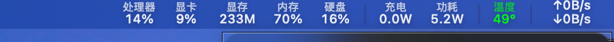

# 系统监测

macOS 菜单栏实时性能监测小工具。Swift 单文件实现（约 1000 行），不依赖第三方库，编译产物是一个没有 Dock 图标的菜单栏 App。



## 功能

菜单栏常驻显示（可横向滚动、宽度自适应）：

- CPU 总占用 / 单核占用、当前频率、封装温度
- GPU 占用（按提交速率估算）、显存占用、GPU 频率与温度
- 内存已用 / 总量 / 压缩内存 / 活跃页 / 空闲
- 网络实时上行、下行速率
- 功耗：电池放电功率、充电功率、CPU 封装功耗（SMC `PCPT`）、整机功耗（若 SMC 提供 `PSTR`/`PDTR`）
- 电池电量、是否充电 / 是否接电源、剩余时间、电池温度

交互：

- 鼠标悬停菜单栏条目 → 弹出该指标的说明提示
- 点击菜单栏 → 展开详情面板（各子系统分项、进程级 top 列表、历史曲线）

## 编译与安装

```bash
./build.sh
```

`build.sh` 做的事：

1. `swiftc -O -framework Cocoa` 编译 `系统监测.swift` 为可执行文件 `系统监测`
2. 拷贝到 `/Applications/系统监测.app/Contents/MacOS/`
3. `codesign --force --deep --sign -` 做 ad-hoc 签名
4. 用 `launchctl bootstrap gui/$(id -u)` 加载 `~/Library/LaunchAgents/com.local.xitongjiance.plist`，实现开机自启

前提：已安装 Xcode Command Line Tools（`xcode-select --install`），并且 `/Applications/系统监测.app` 目录已存在（首次可自行建一个最小 App 包骨架）。

## 手动运行

```bash
swiftc -O -framework Cocoa -o 系统监测 系统监测.swift
./系统监测
```

## LaunchAgent 示例

`~/Library/LaunchAgents/com.local.xitongjiance.plist`：

```xml
<?xml version="1.0" encoding="UTF-8"?>
<!DOCTYPE plist PUBLIC "-//Apple//DTD PLIST 1.0//EN" "http://www.apple.com/DTDs/PropertyList-1.0.dtd">
<plist version="1.0">
<dict>
    <key>Label</key><string>com.local.xitongjiance</string>
    <key>ProgramArguments</key>
    <array><string>/Applications/系统监测.app/Contents/MacOS/系统监测</string></array>
    <key>RunAtLoad</key><true/>
    <key>KeepAlive</key><true/>
</dict>
</plist>
```

## 说明与限制

- 数据采集主要走 `host_statistics` / `IOReport` / `IOService`（AppleSMC、IOAccelerator）等系统接口，不注入任何内核扩展。
- 部分指标（封装功耗、GPU 频率等）依赖 `powermetrics` 或 SMC 键值，取不到时会显示 `—`，属于正常降级。
- 目标是 macOS 12+（在 macOS 26 Tahoe 的黑苹果机器上长期使用）。
- 单文件、无网络请求、不上报任何数据。

## 许可

[MIT License](LICENSE) © 2026 haishendaxian
